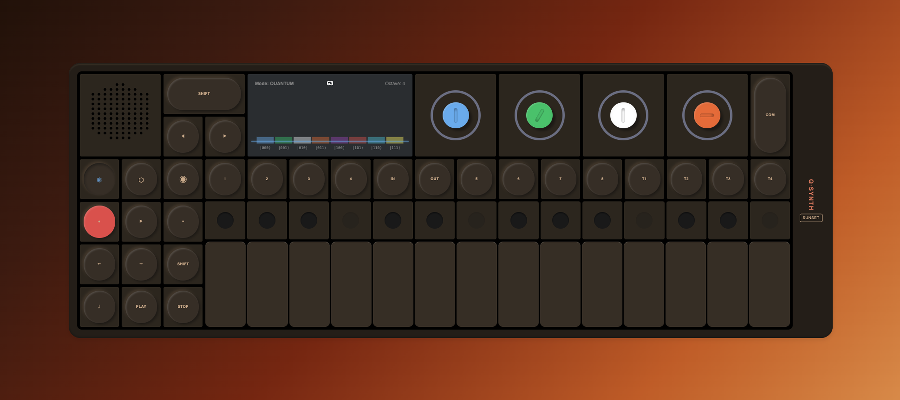
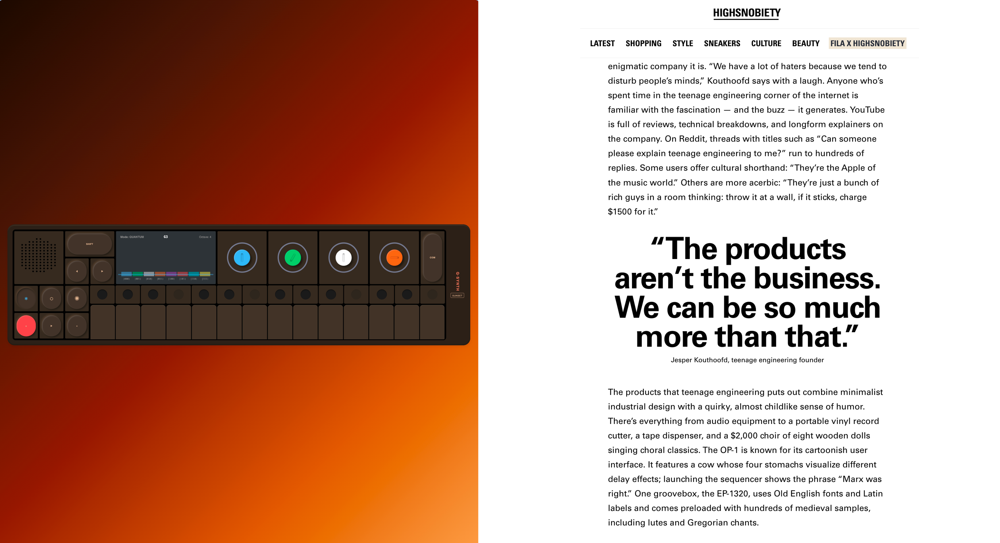
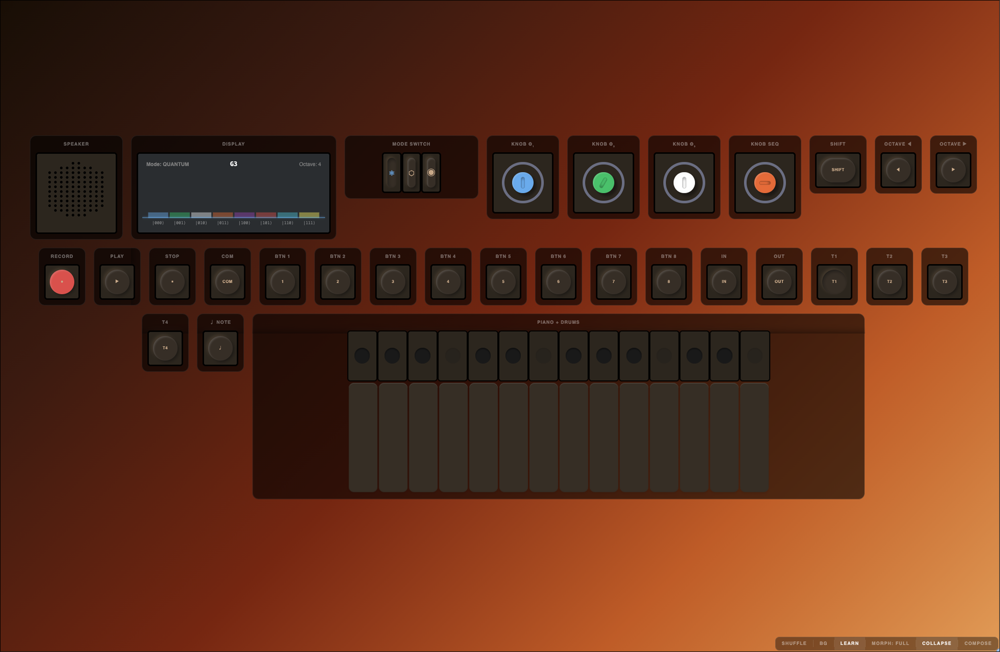

 # Wind Field 

🌪️ 🍂 Wind Field is an experimental, science-facing browser instrument. Its current
surface is an [OP-1 Field](https://teenage.engineering/products/op-1)-inspired synthesizer called Q·Synth; it is not a
hardware emulator, a copy of the OP-1 firmware, or a validated scientific
instrument.



## Current implementation

Q·Synth is built with Svelte 5 and Vite. Its current features include:

- OP-1-style controls, a piano/drum surface, themes, and compact or exploded
  layouts.
- A browser audio engine using Tone.js, including local audio-file loading and
  24-key sample slicing.
- Quantum, chemistry, and ecology modes, with the quantum circuit simulation
  factored into `packages/qvm-core`.
- A component composer for rearranging the control surface.

The browser app runs without a backend service. Its quantum circuit
implementation lives in `packages/qvm-core`; hardware-controller integration
is not implemented.

### What the science modes mean today

- **Quantum:** runs a small state-vector circuit and maps its probabilities to
  a generated melody. This is a simulation, not a quantum-computing backend.
- **Chemistry:** currently plays a fixed illustrative amino-acid sequence; it
  does not yet load or validate molecular data.
- **Ecology:** is present in the mode selector, but its sonification is not
  implemented yet.

Several OP-1-style controls are still visual placeholders. Recording, track
selection, pattern slots, and a real step sequencer are not implemented.

## Concept

“Wind Field” brings together two ideas without implying that the current
application simulates wind. A wind instrument turns airflow and gesture into
sound; in physics, a field describes a quantity distributed across space and
time. The project explores how scientific data might become a changing,
playable sound field, with mappings from data values to notes, rhythm, and
timbre.

An important design goal is to make those mappings inspectable and repeatable.
For each scientific sonification, the data source and time window, any
normalization, and the musical dimensions being encoded should be documented.
The instrument is an exploratory lens that can complement scientific analysis,
not replace it.

## Design references

The [Highsnobiety interview with Teenage Engineering's
founder](https://www.highsnobiety.com/p/teenage-engineering-interview/)
discusses curiosity, playful experimentation, and work across product
categories. These ideas inform Wind Field's approach to making an instrument
that can connect music and science. The reference is to a creative approach,
not to Teenage Engineering's branding, product identity, or proprietary design.




## Development roadmap



1. Improve sample-loading reliability, including decode errors, slice
   boundaries, repeated triggers, and resource cleanup; test across browsers.
2. Implement a step sequencer with explicit tempo, pattern state, transport,
   and reliable start/stop behavior.
3. Define working functions for the OP-1-inspired controls and support
   accessible keyboard and pointer interaction.
4. Add a nanoPAD2-inspired controller surface that shares the audio and event
   model with other instrument profiles.
5. Develop documented data-to-sound mappings for quantum, ecology, and
   chemistry in response to specific datasets and scientific questions.

## Run locally

Requirements: Node.js 18+ and pnpm 9+.

```sh
pnpm install
pnpm dev
```

Check and build:

```sh
pnpm typecheck
pnpm test
pnpm build
```
